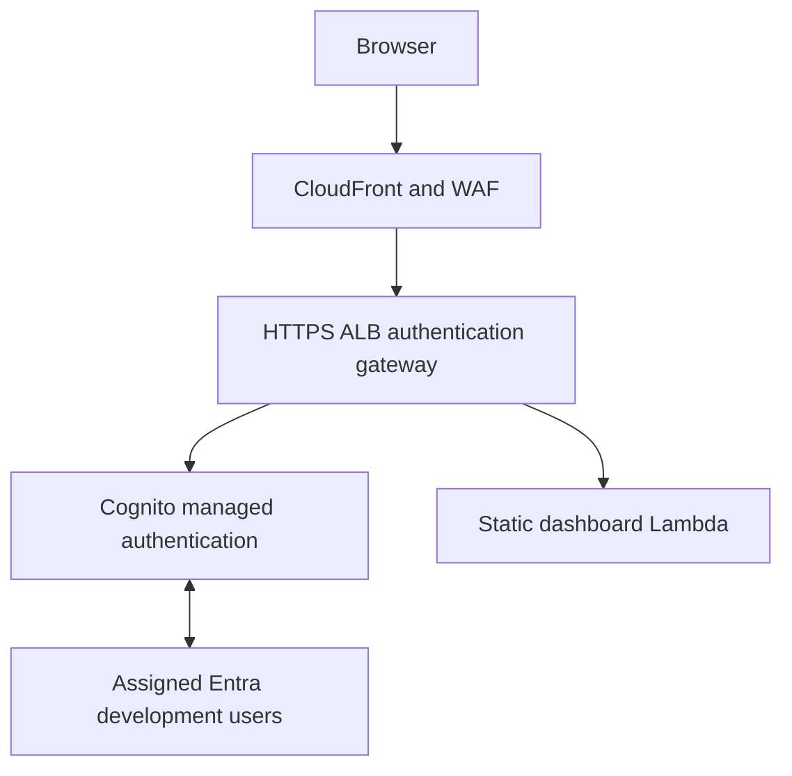

# Development authentication boundary

This is a development foundation for Zero Trust access, not an assertion of production readiness. It protects delivery of the existing static prototype. It does not implement IVMS record authorization, live feeds, device management or compliance controls.

CloudFront forwards all viewer headers, cookies and query strings over HTTPS 443. The single default behavior disables caching and permits GET/HEAD only. There are no unauthenticated asset behaviors, SPA error rewrites or public bucket origins. CloudFront's default hostname fails the ALB host condition; users must use the approved viewer hostname. Authentication redirects and callback parameters must reach the ALB unchanged.

The ALB accepts 443 only from the AWS managed CloudFront origin-facing prefix list. This prefix list is shared with other distributions, so a generated 48-character origin header is also mandatory. CloudFront overwrites the viewer's header. The HTTPS listener defaults to 403; its only forwarding rule requires the header AND viewer hostname, then executes Cognito authentication before forwarding. No HTTP listener, function URL, public storage content, alternate origin or origin health-check route exposes the application. ALB to Lambda is a service invocation authorized for its target group, rather than a public HTTP hop.

The origin header is generated in Secrets Manager and referenced dynamically in CloudFormation. It is available to principals who can inspect the deployed CloudFront/ALB configuration; restrict those read permissions. It is not a substitute for user authentication. Rotation requires coordinated refresh of both resource properties; changing the secret alone does not refresh resolved dynamic references.

Cognito permits only the Entra SAML provider for its confidential OAuth client. Native password/SRP/custom sign-in and self registration are disabled. OAuth uses authorization code grant; callback is exactly `https://VIEWER_DOMAIN/oauth2/idpresponse`. ALB handles callback state, token exchange and secure session cookies. Sessions last 15 minutes; access/ID tokens last 15 minutes and refresh tokens one hour. Entra Conditional Access and assignments provide workforce access control; Cognito's local password policy does not enforce Entra MFA. Existing ALB sessions do not immediately disappear when a user is disabled in Entra.

The Lambda returns a no-store response, CSP with hashes for the existing inline script, framing protection and restrictive browser permissions. Inline styles are retained for the prototype and Maps requires approved Google origins. It never logs requests or uses unsigned identity headers to identify users. AWS IAM must deny unrelated principals direct Lambda invocation; the resource policy scopes ALB invocation. Any future personalized service must independently validate the ALB ES256 JWT, pin its signer ARN and issuer/client/expiry, and authorize each resource. It must not trust `x-amzn-oidc-identity` or `x-amzn-oidc-accesstoken` alone.

WAF applies IP rate limiting and the AWS common managed rules. Test SAML and OAuth flows against managed rules before admitting users; do not disable WAF wholesale to solve a callback failure. Logs are encrypted, private and retained: ALB and CloudFront access logs expire after 90 days, rejected VPC flow logs and application logs after one month. CloudFront cookie logging and WAF request sampling are disabled. Access logs can still include OAuth codes in query strings and IP addresses; restrict and audit log access. Alarms cover Lambda errors and ALB 5xx, but notification destinations must be approved and attached before use.

An internet-facing ALB spans two public subnets with no NAT gateways. Its outbound HTTPS is needed for managed authentication. The CloudFront managed prefix list has significant security-group quota weight; check the account quota first. ALB, WAF, Secrets Manager, logs and CloudFront have ongoing costs even for this prototype. Do not treat the stack as free-tier or a production design. Deployment must use a dedicated nonproduction AWS account, approved DNS names and no real IVMS data.

References:

- [ALB authentication and CloudFront requirements](https://docs.aws.amazon.com/elasticloadbalancing/latest/application/listener-authenticate-users.html)
- [Restrict ALB origin access from CloudFront](https://docs.aws.amazon.com/AmazonCloudFront/latest/DeveloperGuide/restrict-access-to-load-balancer.html)
- [Cognito third-party SAML setup](https://docs.aws.amazon.com/cognito/latest/developerguide/cognito-user-pools-integrating-3rd-party-saml-providers.html)
